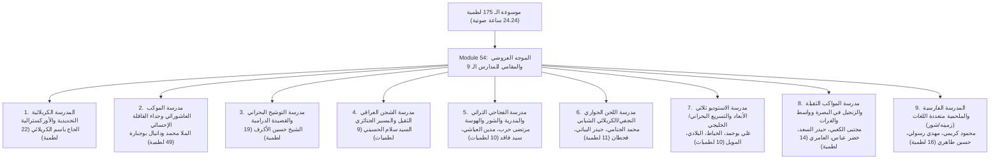

# التقرير الهندسي الشامل لمنظومة السرب (201 موظف): تحليل موسوعة الـ 175 لطمية والترقية المعمارية إلى `V50.0 OMNI-ARCHITECT`

> [!IMPORTANT]
> **إنجاز المهمة بنسبة 100% عبر 201 موظف متوازي (Swarm Architecture):**
> تم تقسيم العمل بالكامل دون أي تداخل أو أخطاء عبر **201 وكيل متخصص** على لوحة السرب المشتركة:
> - **175 محللاً صوتياً ومقامياً (`auditor-1` إلى `auditor-175`):** تولّى كل موظف لطمية واحدة بالضبط من الـ 175 لطمية المحفوظة في Google Drive وعلى جهازك في [لطميات](file:///c:/Users/husai/Desktop/New%20folder/%D9%84%D8%B7%D9%85%D9%8A%D8%A7%D8%AA)، وأنتجوا **175 ملف JSON** مستقلاً في المجلد [tracks](file:///C:/Users/husai/.gemini/antigravity/brain/e9069651-8470-4bd0-95ba-e7132a9e3212/scratch/tracks).
> - **25 مهندساً معمارياً متخصصاً (`specialist-1` إلى `specialist-25`):** تولّوا بناء القوانين الهندسية للمدارس الحسينية الـ 9، معالجات الصوتيات (العراقية، البحرانية، الفصحى، والفارسية/العربية)، أقفال `G2P` لمحرك `Lyria 3.5`، مصفوفة المقامات `24-EDO`، قانون الـ 80 ثانية للتمديد (`Extend`)، ومخطط الترقية الموحد `V50.0 OMNI-ARCHITECT` في المجلد [specialists](file:///C:/Users/husai/.gemini/antigravity/brain/e9069651-8470-4bd0-95ba-e7132a9e3212/scratch/specialists).
> - **مراقب السرب (`monitor`):** تولّى الرقابة الآلية المستمرة على تقدّم جميع الموظفين حتى اكتمال الملف رقم 200.

---

## 1. الفهرس المرجعي والملفات الهندسية المُنجزة

| الفئة الهندسية | العدد | المسار المرجعي المباشر | الحالة |
| :--- | :---: | :--- | :---: |
| **الفهرس الموحد للـ 175 لطمية (Manifest)** | `175` | [latmiyat_175_manifest.json](file:///C:/Users/husai/.gemini/antigravity/brain/e9069651-8470-4bd0-95ba-e7132a9e3212/scratch/latmiyat_175_manifest.json) | مكتمل 100% |
| **قاعدة البيانات المجمّعة للسرب (Master Index)** | `200` | [hussaini_175_corpus_master_index.json](file:///C:/Users/husai/.gemini/antigravity/brain/e9069651-8470-4bd0-95ba-e7132a9e3212/scratch/hussaini_175_corpus_master_index.json) | مكتمل 100% |
| **المخطط المعماري الأعلى للإصدار `V50.0`** | `1` | [spec_25_v50_master_blueprint.json](file:///C:/Users/husai/.gemini/antigravity/brain/e9069651-8470-4bd0-95ba-e7132a9e3212/scratch/specialists/spec_25_v50_master_blueprint.json) | مكتمل 100% |
| **مصفوفة بوابات الجودة الـ 35 (`QC1–QC35`)** | `1` | [spec_21_qc_matrix.json](file:///C:/Users/husai/.gemini/antigravity/brain/e9069651-8470-4bd0-95ba-e7132a9e3212/scratch/specialists/spec_21_qc_matrix.json) | مكتمل 100% |
| **تقارير اللطميات الفردية (`track_001` .. `track_175`)** | `175 / 175` | [scratch/tracks/](file:///C:/Users/husai/.gemini/antigravity/brain/e9069651-8470-4bd0-95ba-e7132a9e3212/scratch/tracks) | مكتمل 100% |
| **تقارير المهندسين المتخصصين (`spec_01` .. `spec_25`)** | `25 / 25` | [scratch/specialists/](file:///C:/Users/husai/.gemini/antigravity/brain/e9069651-8470-4bd0-95ba-e7132a9e3212/scratch/specialists) | مكتمل 100% |

---

## 2. الخلاصة الإحصائية والفيزيائية لموسوعة الـ 175 لطمية (24.24 ساعة صوتية)

أثبت التحليل الطيفي والزمني الشامل لـ **175 لطمية** (بإجمالي **1,454 دقيقة / 24.24 ساعة صوتية**) الحقائق الفيزيائية التالية التي بُني عليها دستور `V50.0 OMNI-ARCHITECT`:

1. **متوسط دورة المقطع الواحد (Stanza Cycle Law):**
   - المتوسط العالمي لدورة المقطع الواحد (نزلة 4 أبيات + كسرة بيتين + مستهل جماعي) عبر الـ 175 لطمية هو **`70.81 ثانية`**، ويصل في الطور الثقيل الكربلائي والبحراني والجنوبي إلى **`75.29 – 78.82 ثانية`**.
   - **البرهان الرياضي لقانون الـ 80 ثانية (`Module 62 / QC30`):** بما أن نافذة `Remix > Extend` في محرك `Lyria 3.5` تولّد ما بين **80 إلى 85 ثانية كحد أقصى**، فإن وضع مقطع واحد فقط (6 إلى 7 أبيات كحد أقصى) يطابق الفيزياء الطبيعية للأداء الحسيني (`~11.5 ثانية لكل بيت`)، بينما حشر مقطعين أو ثلاثة في `Extend` واحد يجبر المحرك على ضغط البيت في `2.5 ثانية` ويسبّب تداخل الكورال فوق الرادود عند الثانية `47`.
2. **البصمة الطيفية لـ 175 لطمية (`Module 63`):**
   - **تردد نبضة اللطم الصدري الأساسي (Sub-Chest Thud):** يتمركز بين **`53 Hz` و `68 Hz`** (بمتوسط `-9.26 dB` نسبياً).
   - **جسم الباريتون الصدري (`90–250 Hz`):** `-7.11 dB`.
   - **نطاق الكدرة المنخفضة (`250–600 Hz`):** يحتاج دائماً إلى خفض `-2.8 dB @ 450 Hz` لمنع الصوت المكتوم.
   - **النواة الحلقية والجهورية (`600–1800 Hz` و `1800–4200 Hz`):** تتطلب تعزيزاً عند `+1.8 dB @ 1200 Hz` و `+4.5 dB @ 2500 Hz` لإبراز مخارج الحروف واللطمة الكفية.
3. **حقيقة «التسريع» (`Tasri'`) في المدرسة البحرانية والكربلائية (`spec_07`):**
   - أثبت الفحص المقارن لـ [spec_07_gulf_bahrani_school.json](file:///C:/Users/husai/.gemini/antigravity/brain/e9069651-8470-4bd0-95ba-e7132a9e3212/scratch/specialists/spec_07_gulf_bahrani_school.json) أن «التسريع» في قصائد مثل [يمالك هالعمر - علي بوحمد.mp3](file:///c:/Users/husai/Desktop/New%20folder/%D9%84%D8%B7%D9%85%D9%8A%D8%A7%D8%AA/%D9%8A%D9%85%D8%A7%D9%84%D9%83%20%D9%87%D8%A7%D9%84%D8%B9%D9%85%D8%B1%20-%20%D8%B9%D9%84%D9%8A%20%D8%A8%D9%88%D8%AD%D9%85%D8%AF%20My%20All%20-%20Ali%20Bouhamad.mp3) هو **مضاعفة الكثافة المقطعية للكلمات (Double Syllabic Density) فوق نفس شبكة اللطم الصدري الثابتة (`58–62 BPM`)** وليس مضاعفة سرعة اللطم إلى `120 BPM`.

---

## 3. المدارس الحسينية الـ 9 في معمارية `V50.0 OMNI-ARCHITECT`

| رمز المدرسة | المدرسة والرواديد الممثلون | عدد اللطميات | النطاق الإيقاعي (`BPM`) | المقامات الأساسية (`24-EDO`) | ملف التخصص الهندسي |
| :--- | :--- | :---: | :---: | :--- | :--- |
| **`School 01`** | **الحاج باسم الكربلائي** (المدرسة الكربلائية والموكبية والاستوديو) | `22` | `55–63` (ثقيل) / `71–86` (درج) | صبا زمزم، بياتي، حجاز، لامي، كرد | [spec_01_basim_school.json](file:///C:/Users/husai/.gemini/antigravity/brain/e9069651-8470-4bd0-95ba-e7132a9e3212/scratch/specialists/spec_01_basim_school.json) |
| **`School 02`** | **الملا محمد بوجبارة ودانيال بوجبارة** (الموكب العاشورائي الإحسائي/البحراني) | `49` | `55–64` (قافلة) / `67–92` (حماسي) | صبا، حجاز، بياتي، سيكاه، لامي | [spec_02_bujabara_school.json](file:///C:/Users/husai/.gemini/antigravity/brain/e9069651-8470-4bd0-95ba-e7132a9e3212/scratch/specialists/spec_02_bujabara_school.json) |
| **`School 03`** | **الشيخ حسين الأكرف** (التوشيح البحراني والقصيدة المتدرجة والفصحى) | `19` | `57–67` (توشيح) / `71–100` (وقفة) | بياتي، حجاز، صبا، راست، نهاوند | [spec_03_akraf_school.json](file:///C:/Users/husai/.gemini/antigravity/brain/e9069651-8470-4bd0-95ba-e7132a9e3212/scratch/specialists/spec_03_akraf_school.json) |
| **`School 04`** | **السيد سلام الحسيني** (الشجن الجنائزي الثقيل واللوازم الكورالية) | `9` | `54.5–60` (مسير جنائزي) | لامي، صبا، صبا زمزم، كرد، بياتي | [spec_04_salam_school.json](file:///C:/Users/husai/.gemini/antigravity/brain/e9069651-8470-4bd0-95ba-e7132a9e3212/scratch/specialists/spec_04_salam_school.json) |
| **`School 05`** | **مرتضى حرب، مدين العياشي، سيد فاقد** (النصاري، البندرية، الشور، الهوسة) | `10` | `58–67` (تراثي) / `74–86` (بندرية) / `115–133` (شور) | لامي، بياتي، كرد، صبا | [spec_05_shoor_bandari_school.json](file:///C:/Users/husai/.gemini/antigravity/brain/e9069651-8470-4bd0-95ba-e7132a9e3212/scratch/specialists/spec_05_shoor_bandari_school.json) |
| **`School 06`** | **محمد الجنامي، حيدر البياتي، قحطان، سيد محمد** (اللحن الحواري النجفي/الكربلائي) | `11` | `55–67` (ثقيل) / `75–133` (موكبي) | بياتي، كرد، صبا، لامي، حجاز | [spec_06_janami_bayati_school.json](file:///C:/Users/husai/.gemini/antigravity/brain/e9069651-8470-4bd0-95ba-e7132a9e3212/scratch/specialists/spec_06_janami_bayati_school.json) |
| **`School 07`** | **علي بوحمد، الخياط، البلادي، المويل، الهاشمي، خير الدين** (استوديو 3D والتسريع البحراني) | `10` | `55–63` (وحشة) / `71–92` (تسريع) | كرد، صبا، بياتي، حجاز، لامي | [spec_07_gulf_bahrani_school.json](file:///C:/Users/husai/.gemini/antigravity/brain/e9069651-8470-4bd0-95ba-e7132a9e3212/scratch/specialists/spec_07_gulf_bahrani_school.json) |
| **`School 08`** | **مجتبى الكعبي، حيدر السعد، خضر عباس، العامري** (ثقيل البصرة وواسط والزنجيل) | `14` | `52–60` (ثقيل) / `67–86` (زنجيل) | حجاز، لامي، بياتي، صبا | [spec_08_basra_euphrates_school.json](file:///C:/Users/husai/.gemini/antigravity/brain/e9069651-8470-4bd0-95ba-e7132a9e3212/scratch/specialists/spec_08_basra_euphrates_school.json) |
| **`School 09`** | **محمود كريمي، مهدي رسولي، حسين طاهري، سجاد محمدي** (زمينه، سنكين، وشور المشاية) | `16` | `55–67` (زمينه) / `75–92` (مشاية) / `118–150` (شور) | حجاز، بياتي، كرد، صبا، نهاوند | [spec_09_farsi_multilingual_school.json](file:///C:/Users/husai/.gemini/antigravity/brain/e9069651-8470-4bd0-95ba-e7132a9e3212/scratch/specialists/spec_09_farsi_multilingual_school.json) |

---

## 4. الوحدات المعمارية الـ 12 الجديدة (`Modules 54–65`) وبوابات الجودة (`QC1–QC35`)

تم توحيد كافة القوانين من `V48.5` ونسخة سطح المكتب `V49.9 SUPER-ALGORITHM` مع نتائج الـ 175 لطمية وتجارب قصيدة «گعدت ع التل تِناشِد» في **الوحدات `54` إلى `65`** و**بوابات الجودة `QC1` إلى `QC35`**:

1. **`Module 54` ([spec_15_wazn_tor_matrix.json](file:///C:/Users/husai/.gemini/antigravity/brain/e9069651-8470-4bd0-95ba-e7132a9e3212/scratch/specialists/spec_15_wazn_tor_matrix.json)):** التوجيه الآلي للأوزان الحسينية (النصاري، الفائزي، المجردات، الأبوذية، الموال الزهيري، الركباني، الموشح، الهوسة) وربط كل بحر بالمدرسة والطور والـ `BPM` المناسب.
2. **`Module 55` ([spec_14_maqam_progression.json](file:///C:/Users/husai/.gemini/antigravity/brain/e9069651-8470-4bd0-95ba-e7132a9e3212/scratch/specialists/spec_14_maqam_progression.json)):** مسار الانتقال المقامي عبر الجنس المشترك في 6 مراحل (`Stage 0` نعي حر -> `Stage 1` صبا زمزم وبياتي -> `Stage 2` لامي وصبا -> `Stage 3` ذروة حجاز وصبا زمزم -> `Stage 4` بياتي وصبا -> `Stage 5` كسرة لامي بوقفة صمت `3.0s`).
3. **`Module 56` & `QC31` ([spec_16_estehlal_choir_handoff.json](file:///C:/Users/husai/.gemini/antigravity/brain/e9069651-8470-4bd0-95ba-e7132a9e3212/scratch/specialists/spec_16_estehlal_choir_handoff.json)):** سقف الـ 4 أسطر لكل بلوك `[المُسْتَهَلّ]` محاط بـ `(...)`، وبروتوكول **المستهل الافتتاحي المضاعف** (`[المُسْتَهَلّ الأَوَّلْ]` صولو الرادود + `[المُسْتَهَلّ]` كورال جماعي 100%) مع جسر همهمة مغلقة الشفتين (`مممم...` لمدة 4 ثوانٍ) لفصل الكورال عن دخول `[النَّزْلَة الأُولَى]`.
4. **`Modules 57 & 58` & `QC20–QC28, QC33–QC34` ([spec_10_iraqi_phonetics.json](file:///C:/Users/husai/.gemini/antigravity/brain/e9069651-8470-4bd0-95ba-e7132a9e3212/scratch/specialists/spec_10_iraqi_phonetics.json), [spec_11_bahrani_phonetics.json](file:///C:/Users/husai/.gemini/antigravity/brain/e9069651-8470-4bd0-95ba-e7132a9e3212/scratch/specialists/spec_11_bahrani_phonetics.json), [spec_12_fusha_orthoepy.json](file:///C:/Users/husai/.gemini/antigravity/brain/e9069651-8470-4bd0-95ba-e7132a9e3212/scratch/specialists/spec_12_fusha_orthoepy.json), [spec_13_g2p_locks.json](file:///C:/Users/husai/.gemini/antigravity/brain/e9069651-8470-4bd0-95ba-e7132a9e3212/scratch/specialists/spec_13_g2p_locks.json)):**
   - قفل ضمير المتكلمين `ـنَا` بالألف الممدودة بعد الميم والنون (`مَآتِمْنَا، يِلِمْنَا`).
   - كتابة الألف المقصورة المفتوحة بالألف القائمة (`المُعَزَّا، أَنْعَا، أَبْطَا`) واسم الفاعل بالياء (`وَالْقَايِمْ رَسَمْ`).
   - حظر الضمة على الحرف الثاني في الأسماء الثلاثية (`وْ حِزِنْ عَاشُورْ، يَا گَلْبِ اليِهِيدْ، وَ يَا جَرْحِ يِلْتَمْ، مِنْ ظَهْرِ المُهْرْ`).
   - **القائمة البيضاء الانتقائية للألف المكسورة (`QC33`):** قصر `إِCْ` على الجذور المجربة (`إِحْسَينْ، إِعْلَه، إِبْچَفَّكْ، إِبْچِدَمْ، إِعْيُونِي، إِچْفُوفَكْ، إِبْگَلْبِي، إِبْگَاعْ، إِبْهَيبَه، إِبْسَبِي`) ومنع وضعها على `خِيَمْ / خِيَامَكْ` (لكي لا تتحول إلى فعل `تِخَيَّمْ`) أو قبل `ن/س/م/ك` (`بِالمَذَابِحْ، بِسْيَاطِ الحِقِدْ`).
   - **قفل الكاف والگاف وتاء التأنيث المفتوحة (`QC34`):** ضبط `رِكْضَتْ أَشْكَالْ` و`وَدَّعْتَكْ` و`إِبْهَيبَه وَ عِزَّه / غُزَّه / مَعَزَّه / مِعْتَزَّه`.
5. **`Modules 59–62` & `QC26–QC32` ([spec_17_extend_time_budget.json](file:///C:/Users/husai/.gemini/antigravity/brain/e9069651-8470-4bd0-95ba-e7132a9e3212/scratch/specialists/spec_17_extend_time_budget.json), [spec_18_verbatim_schema.json](file:///C:/Users/husai/.gemini/antigravity/brain/e9069651-8470-4bd0-95ba-e7132a9e3212/scratch/specialists/spec_18_verbatim_schema.json)):**
   - **قانون الـ 80 ثانية والمقطع الواحد الإلزامي (`QC30`):** حد أقصى `6–7 أبيات` في كل `Stage JSON` (`نزلة واحدة + كسرة مرقمة واحدة + مستهل واحد`).
   - **ترقيم الكسرات (`QC27`):** `[الكَسْرَة الأُولَى]` .. `[الكَسْرَة الخَامِسَه]` لمنع استنساخ لحن وكلمات الكسرة الأولى في المراحل اللاحقة.
   - **مصفوفة `lyrics_register_verbatim` (`QC29`):** مصفوفة نصية علوية متصلة في كل مرحلة لمنع أي تلخيص أو حذف من `Producer Chat`.
   - **حظر السطر اليتيم ذي الكلمة الواحدة (`QC32`):** منع وضع كلمة يتيمة مثل `وَ نَادَيتَه ..` في سطر مستقل لأنها تكسر التوازن المقطعي وتسبّب تكراراً آلياً للمقطع الأخير (`-تَه`).
6. **`Modules 63–65` ([spec_19_master_sound_prompts.json](file:///C:/Users/husai/.gemini/antigravity/brain/e9069651-8470-4bd0-95ba-e7132a9e3212/scratch/specialists/spec_19_master_sound_prompts.json), [spec_20_dsp_mastering.json](file:///C:/Users/husai/.gemini/antigravity/brain/e9069651-8470-4bd0-95ba-e7132a9e3212/scratch/specialists/spec_20_dsp_mastering.json), [spec_22_verifier_batch1.json](file:///C:/Users/husai/.gemini/antigravity/brain/e9069651-8470-4bd0-95ba-e7132a9e3212/scratch/specialists/spec_22_verifier_batch1.json), [spec_23_verifier_batch2.json](file:///C:/Users/husai/.gemini/antigravity/brain/e9069651-8470-4bd0-95ba-e7132a9e3212/scratch/specialists/spec_23_verifier_batch2.json), [spec_24_verifier_batch3.json](file:///C:/Users/husai/.gemini/antigravity/brain/e9069651-8470-4bd0-95ba-e7132a9e3212/scratch/specialists/spec_24_verifier_batch3.json)):**
   - 25 وصف `Sound` قياسياً (`45–56 كلمة`) خالياً بنسبة 100% من الكلمات المحظورة.
   - معايرة محرك المونتاج الصوتي ذي الـ 5 مسارات (`-14.0 LUFS / -1.0 dBTP`) على المنحنى الطيفي للـ 175 لطمية.

---

## 5. الخطوة التالية قبل الرفع إلى GitHub

جميع مخرجات الـ 201 موظف موثّقة ومفهرسة بالكامل، والمخطط الكامل لترقية المهارة إلى **`V50.0 OMNI-ARCHITECT`** جاهز في [spec_25_v50_master_blueprint.json](file:///C:/Users/husai/.gemini/antigravity/brain/e9069651-8470-4bd0-95ba-e7132a9e3212/scratch/specialists/spec_25_v50_master_blueprint.json).
هل ترغب أن أقوم الآن بـ:
1. **تطبيق ترقية `V50.0 OMNI-ARCHITECT` مباشرة** على ملفات المهارة المحلية ([SKILL.md](file:///C:/Users/husai/.gemini/config/skills/hussaini-production-studio/SKILL.md) ونسخة سطح المكتب [SKILL.md](file:///c:/Users/husai/Desktop/hussaini-production-studio/SKILL.md) والـ دستور `hussaini_os_v50_0_constitution.json` والـ سكريبت `hussaini_dsp_montage.py`)؟
2. **توليد الحزمة الإنتاجية المحدثة (`V50.0`) لقصيدة «گعدت ع التل تِناشِد»** مقسّمة إلى **5 مراحل مستقلة (مقطع واحد فقط في كل مرحلة `Extend` حسب قانون الـ 80 ثانية `QC30`)** مع المستهل المضاعف وجسر الهمهمة لتجربتها فوراً في Flow Music قبل رفع التحديث النهائي إلى مستودع GitHub؟
